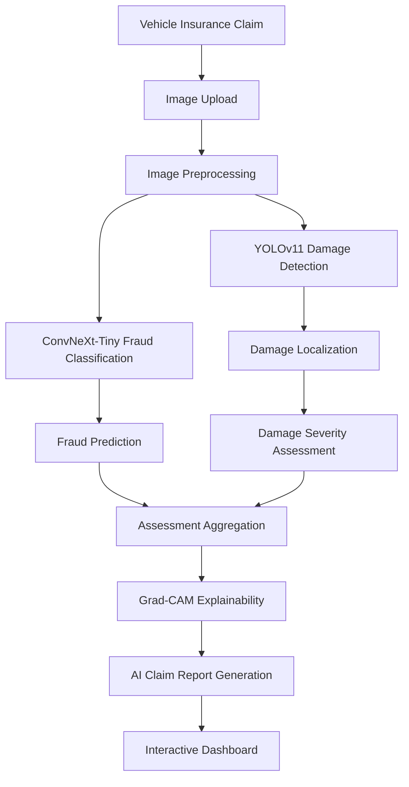

# 🚗 Vehicle Insurance Fraud Detection & Damage Assessment System

An AI-powered vehicle insurance claim assessment system that combines deep learning, computer vision, and explainable AI to detect potentially fraudulent insurance claims, identify vehicle damage, and automate claim report generation.

## 📌 Overview

Vehicle insurance fraud leads to significant financial losses for insurance providers. Traditional claim verification processes often require manual inspection, making them time-consuming, expensive, and susceptible to human error.

This project introduces an AI-driven solution that automates key stages of insurance claim assessment through image classification, vehicle damage detection, severity analysis, and explainable predictions.

The system integrates **ConvNeXt-Tiny** for insurance fraud classification and **YOLOv11** for vehicle damage detection, providing an intelligent approach to claim evaluation.

## ✨ Key Features

- **AI-Based Fraud Detection:** Uses a ConvNeXt-Tiny deep learning architecture to classify potentially fraudulent insurance claims.
- **Vehicle Damage Detection:** Employs YOLOv11 to identify and localize visible vehicle damage in submitted images.
- **Damage Severity Assessment:** Evaluates detected damage to support insurance claim assessment.
- **Explainable AI:** Integrates Grad-CAM visualizations to highlight image regions influencing model predictions.
- **Automated Claim Reports:** Generates AI-assisted claim assessment reports based on model outputs.
- **Interactive Dashboard:** Provides an interface for uploading vehicle images and reviewing assessment results.
- **Containerized Deployment:** Supports Docker-based application deployment.

## 🧠 System Architecture

The system follows a modular AI-powered claim assessment pipeline.



## 🔬 AI Models & Technologies

| Component | Technology | Purpose |
|---|---|---|
| Fraud Classification | ConvNeXt-Tiny | Insurance fraud classification |
| Damage Detection | YOLOv11 | Vehicle damage localization |
| Explainable AI | Grad-CAM | Prediction visualization |
| Damage Assessment | Computer Vision | Damage severity evaluation |
| Backend | Python | Application processing |
| Frontend | Streamlit | Interactive dashboard |
| Deployment | Docker | Containerized deployment |
| Cloud | AWS EC2 | Application hosting |

## 📂 Project Structure

```text
vehicle-18/
│
├── api/                  # API services and backend components
├── app/                  # Application and dashboard
├── artifacts/
│   └── metrics/          # Model evaluation metrics
├── configs/              # Configuration files
├── docs/                 # Project documentation
├── models/               # Trained model files
├── scripts/              # Training and utility scripts
├── src/                  # Core source code
├── tests/                # Unit and integration tests
│
├── .env.example          # Environment variable template
├── .gitattributes
├── .gitignore
├── Dockerfile            # Docker configuration
├── docker-compose.yml    # Container orchestration
├── requirements.txt      # Python dependencies
└── README.md
```

## ⚙️ Installation & Setup

### Prerequisites

- Python 3.10+
- Git
- Docker and Docker Compose (for containerized deployment)

### 1. Clone the Repository

```bash
git clone https://github.com/Alexrohith/vehicle-18.git
cd vehicle-18
```

### 2. Create a Virtual Environment

```bash
python -m venv venv
```

Activate the environment:

**Windows**
```bash
venv\Scripts\activate
```

**Linux / macOS**
```bash
source venv/bin/activate
```

### 3. Install Dependencies

```bash
pip install -r requirements.txt
```

### 4. Configure Environment Variables

Create your environment file using the provided template:

```bash
cp .env.example .env
```

Update the required environment variables according to your deployment configuration.

### 5. Run Using Docker

Build and start the application:

```bash
docker compose up --build
```

To stop the containers:

```bash
docker compose down
```

## 📊 Model Pipeline

### 1. Fraud Classification – ConvNeXt-Tiny

ConvNeXt-Tiny is used as the image classification backbone to analyze submitted insurance claim images and identify potential fraud patterns.

### 2. Damage Detection – YOLOv11

YOLOv11 performs object detection to identify vehicle damage regions and localize damaged components within submitted images.

### 3. Explainable AI – Grad-CAM

Grad-CAM provides visual explanations by highlighting the image regions that contribute most strongly to the classification output.

This improves model interpretability and helps reviewers understand the basis of AI predictions.

### 4. Automated Claim Assessment

The system combines classification and damage assessment outputs to support claim evaluation and generate structured AI-assisted reports.

## 🔍 Explainable AI

Model interpretability is an important aspect of insurance claim assessment.

Grad-CAM visualizations help identify image regions that influenced the model's predictions, providing additional context for human reviewers.

## ☁️ Deployment

The application is designed to support containerized deployment using Docker and cloud hosting through AWS EC2.

The deployment architecture enables the application to run in a consistent environment while separating application components and model-related resources.

## 🎯 Applications

- Automated vehicle insurance claim assessment
- Potential insurance fraud identification
- Vehicle damage inspection
- AI-assisted claim verification
- Insurance workflow automation

## 🚀 Future Enhancements

- Integration with real-time insurance claim management systems.
- Advanced multimodal fraud detection.
- Improved damage cost estimation.
- Integration with external vehicle repair databases.
- Enhanced model monitoring and performance analytics.
- Human-in-the-loop claim verification.

## ⚠️ Disclaimer

This project is intended for research and educational purposes. AI-generated predictions are decision-support signals and should not independently determine whether an insurance claim is fraudulent or eligible for approval. Final decisions require appropriate human verification.

## 👨‍💻 Author

**Alex Rohith I**

Artificial Intelligence & Data Science  
St. Joseph's Institute of Technology

GitHub: [@Alexrohith](https://github.com/Alexrohith)

---

⭐ If you find this project interesting, consider giving the repository a star!
